<div align="center">

# ResumeIQ

### A focused resume-to-role match, with the evidence in view.

Upload a text-based PDF, answer a few questions about your target role, and get an explainable ATS-style score with keyword gaps and practical next steps.

[](https://nextjs.org/)
[](https://react.dev/)
[](https://www.typescriptlang.org/)
[](https://tailwindcss.com/)
[](https://www.npmjs.com/package/pdf-parse)
[](#project-notes)

</div>

---

## The idea

ResumeIQ is a Next.js application for checking how a resume's extracted text aligns with a particular role. Instead of scoring against a made-up job, the guided flow asks for the job title, years of relevant experience, and key skills. Pasting a job description is optional, but gives the analyzer more context.

The score is a transparent, heuristic **ATS-style estimate**, not a score from a specific employer's applicant tracking system. It is meant to help prioritize edits, not predict hiring outcomes.

## The short workflow

```mermaid
flowchart LR
    A[Choose a text-based PDF] --> B[Enter target job title]
    B --> C[Report relevant years]
    C --> D[List key role skills]
    D --> E[Optionally paste job description]
    E --> F[Extract PDF text]
    F --> G[Parse resume sections and skills]
    G --> H[Compare role keywords and experience]
    H --> I[Show ATS-style score and breakdown]
    I --> J[Review gaps and truthful suggestions]
```



### What the analysis considers

| Scoring category | Weight | Signals |
|---|---:|---|
| Required keyword and skill coverage | 30% | Applicant-provided target skills found in the extracted resume text |
| Relevant experience alignment | 25% | Reported experience, detected work entries, and action-oriented bullets |
| Qualifications and education | 15% | Parsed education content |
| Projects and achievements | 15% | Parsed projects and certifications |
| Resume structure | 10% | Common resume sections detected in extracted text |
| Contact completeness | 5% | Email, phone, and professional links detected |

The score weights total 100%. When an optional signal is absent, the breakdown notes what the text parser could or could not detect. Visual design qualities such as columns, font size, and spacing are not evaluated.

## A few useful details

- **PDF-first intake:** the current upload flow accepts text-based PDF files up to 10 MB.
- **Four concise prompts:** target title, years of experience, key skills, and an optional job description.
- **Readable results:** overall score, category breakdown, matched and missing keywords, formatting notes, and suggestions.
- **Evidence-led edits:** recommendations are based on extracted content and do not add invented metrics or qualifications.
- **Demo mode:** load the bundled synthetic candidate when you want to explore the interface without uploading a resume.
- **Resume tools:** existing editor, comparison, history, and export views are available in the app.

## Technology

| Area | Stack |
|---|---|
| Web application | Next.js 14 App Router, React 18, TypeScript 5 |
| Styling | Tailwind CSS 3, PostCSS |
| Icons and UI helpers | Lucide React, `clsx`, `tailwind-merge` |
| PDF text extraction | `pdf-parse` 2.x / PDF.js, server-side Node.js route |
| Resume parsing and scoring | Local TypeScript rules, section patterns, and skill vocabulary |
| Browser feedback | `canvas-confetti` |
| Data store | In-memory maps shared within the running Node.js process |

## Run locally

**Prerequisites:** Node.js 20 or newer and npm. Install Git separately if you want to use the repository commands.

```powershell
npm.cmd install
npm.cmd run dev
```

Open [http://localhost:3000](http://localhost:3000). To check the project before a change is shared:

```powershell
npm.cmd run type-check
npm.cmd run build
```

If PowerShell reports that `npm` or `git` is not recognized, install the corresponding Windows tool and reopen VS Code so the new PATH is loaded. To start version control in a project that has not been initialized yet, run `git init` from the project root. `git initdev` is not a Git command.

## Project map

```text
app/
  api/                 Next.js route handlers for resumes, jobs, and analyses
  dashboard/           Resume analysis dashboard
  editor/              Structured resume editor
  history/             Analysis and version history
  job/                 Job-description matcher
components/
  analyzer/             Score, keyword, category, and suggestion views
  common/               App shell and guided PDF intake
  editor/               Resume editor interface
lib/
  api.ts                Browser API client
  db.ts                 In-memory application store
  export.ts             Resume document HTML generation
  parser.ts             Resume and job requirement parsing
  scoring.ts            Weighted ATS-style scoring rules
```

## API overview

The app exposes its API through Next.js route handlers under `/api`:

| Method | Endpoint | Purpose |
|---|---|---|
| `POST` | `/api/resumes/upload` | Validate and extract text from a PDF |
| `POST` | `/api/resumes/sample` | Load the synthetic demo resume |
| `POST` | `/api/job-descriptions` | Create role requirements from intake answers |
| `POST` | `/api/analyses` | Calculate and save the role-specific score |
| `GET` | `/api/analyses` | List analyses in the running process |
| `POST` | `/api/resumes/{id}/export/pdf` | Prepare a resume PDF export |

Other routes support resume editing, versions, comparisons, dashboard history, and authentication flows. They are implemented in `app/api/`.

## Project notes

- **Scanned PDFs:** image-only PDFs are rejected with a clear message. OCR is not currently included.
- **PDF layout:** the analyzer evaluates extracted text only; it cannot verify multi-column reading order or visual formatting.
- **Parsing scope:** section and skill detection uses local patterns and a finite skill list. It is not a general-purpose document understanding model.
- **Storage:** resumes, jobs, analyses, and versions are kept in process memory. Restarting the server clears them; this is not production persistence.
- **Docker:** the checked-in `docker-compose.yml` references legacy `backend/` and `frontend/` directories that are not part of the current project. Use the local Node.js setup above.
- **License:** no license has been specified for this repository.

---

<div align="center">

Built to make the next resume edit clearer, smaller, and easier to verify.

</div>
