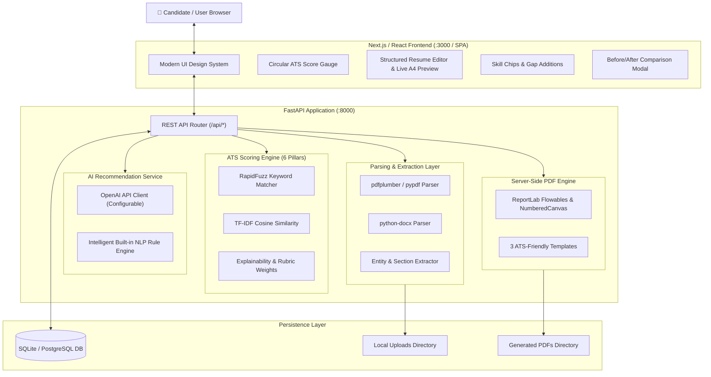
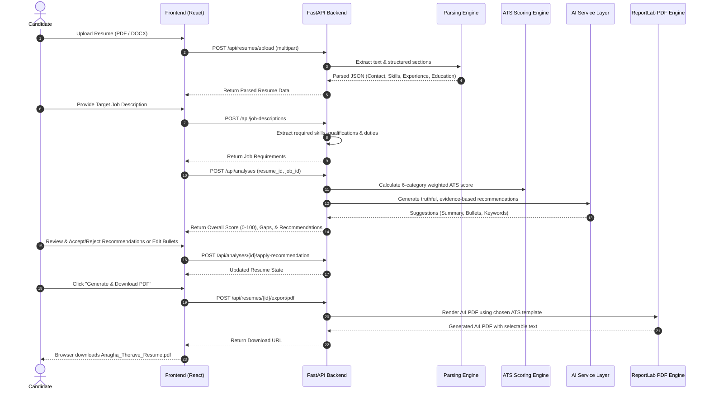
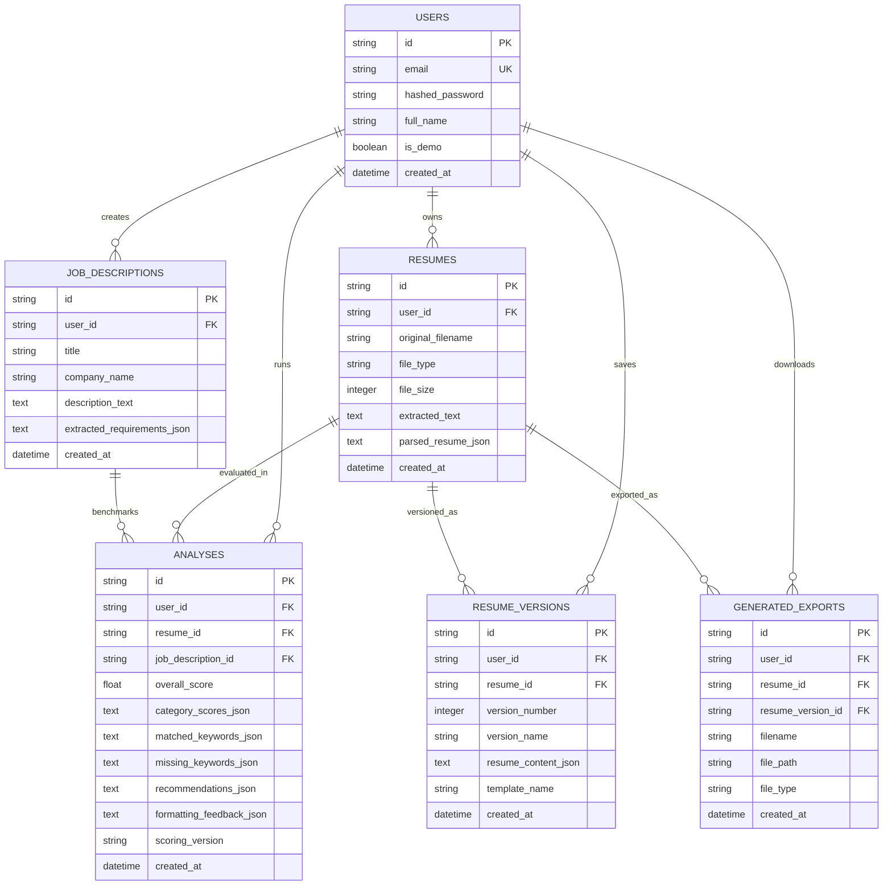

# ResumeIQ — Architecture & Request Flow

ResumeIQ is an enterprise-grade AI Resume Parser and ATS (Applicant Tracking System) Compatibility Scoring Platform built with a high-performance Python FastAPI backend and a responsive React frontend.

---

## 1. High-Level System Architecture

---

## 2. End-to-End Request Flow

---

## 3. Database Entity-Relationship Model

---

## 4. Scoring Rubric Specifications

| Pillar | Weight | Evaluation Method |
|---|---:|---|
| **Required Keyword & Skill Coverage** | 30% | Exact match, synonym expansion, and fuzzy token matching against required job skills. |
| **Relevant Experience Alignment** | 25% | TF-IDF semantic cosine similarity with role responsibilities + action verb density in bullet points. |
| **Qualifications & Education** | 15% | Degree level verification, institution presence, and graduation timeline parsing. |
| **Projects & Achievement Relevance** | 15% | Practical technology overlap in candidate projects and verified professional certifications. |
| **Resume Structure & Readability** | 10% | Detection of ATS-friendly linear layout, standard headings, bullet points vs. paragraphs, and table avoidance. |
| **Contact Information & Completeness** | 5% | Presence of valid email, phone, location, LinkedIn, and GitHub links. |
